# Tracer Study - SMAIT AL-ITTIHAD

## 📌 Deskripsi Project

Tracer Study merupakan sistem informasi berbasis web yang dirancang untuk membantu pihak sekolah dalam memperoleh informasi mengenai aktivitas dan perkembangan alumni setelah lulus.

## ✨ Fitur

### 1. Landing Page
- Visualisasi Grafik Alumni.
- Informasi Periode Pengisian.
- Informasi Tata Cara Pengisian.

### 2. Level User
- Role Admin.
- Role User.

### 3. Dashboard
- Ringkasan Jumlah Alumni.
- Visualisasi Alumni berdasarkan angkatan menggunakan donut chart.
- Visualisasi jumlah Alumni yang sudah mengisi berdasarkan angkatan menggunakan horizontal bar chart.

### 3. Jadwal/Periode
- Pengelolaan Data jadwal dan periode.
- Setting status Aktif/Tidak Aktif jadwal dan periode.

### 4. Kuisioner
- Pengelolaan Data Kuisioner.
- Penyesuaian Jenis/Tipe Pertanyaan Kuisioner.
- Penyesuaian Jumlah Pilihan Ganda Kuisioner.

### 5. Alumni
- Pengelolaan Data Alumni.
- Detail Profil Alumni.
- Jawaban Isian Kuisioner Alumni.

## 🛠️ Teknologi yang Digunakan

- PHP 7.4
- Laravel 8
- MySQL
- Bootstrap
- JavaScript
- Composer

## 📸 Application Screenshots

### 1. Landing Page
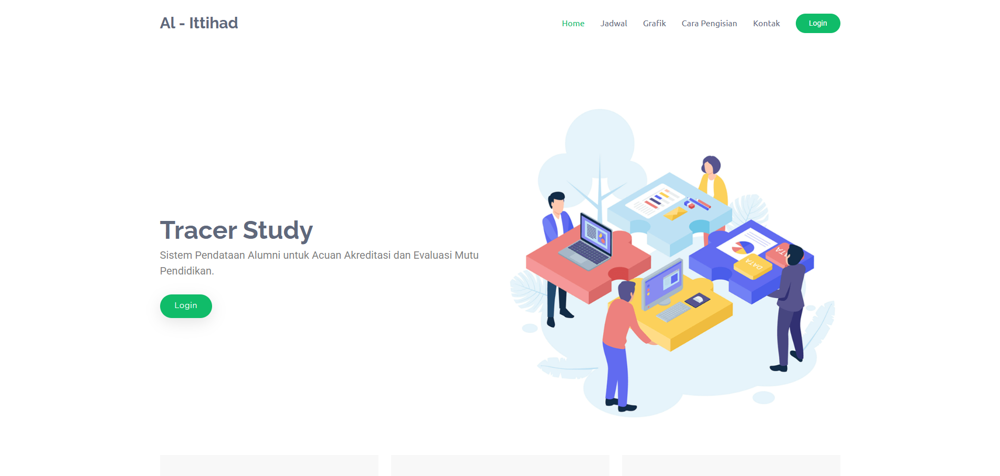
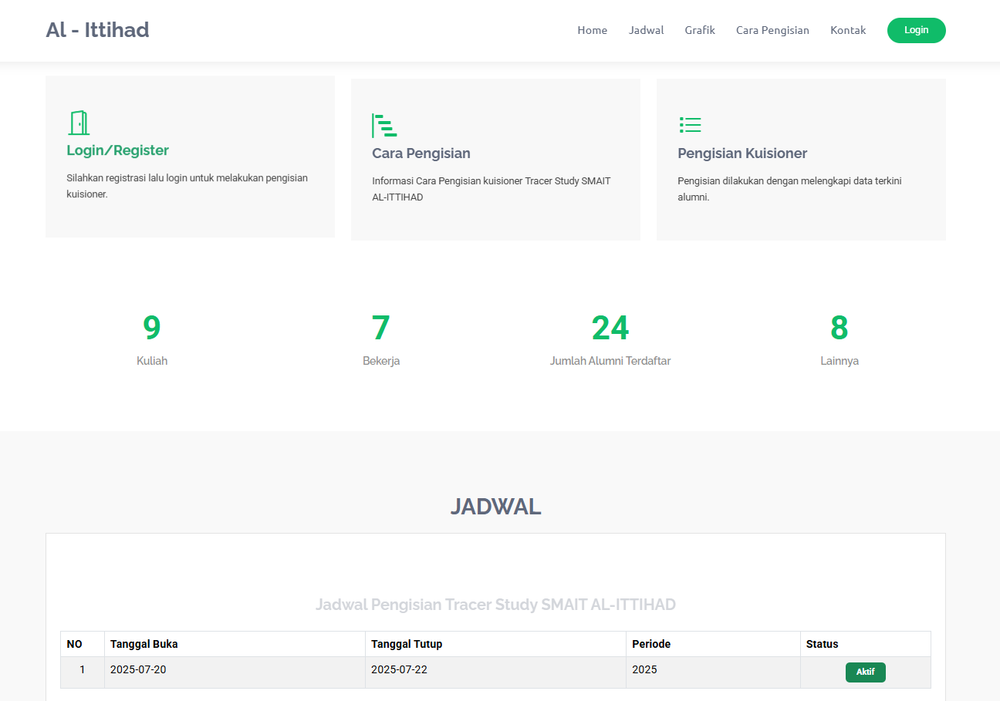

### 2. Login and Regist
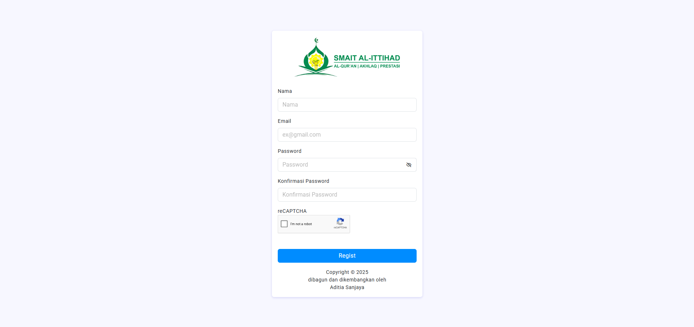
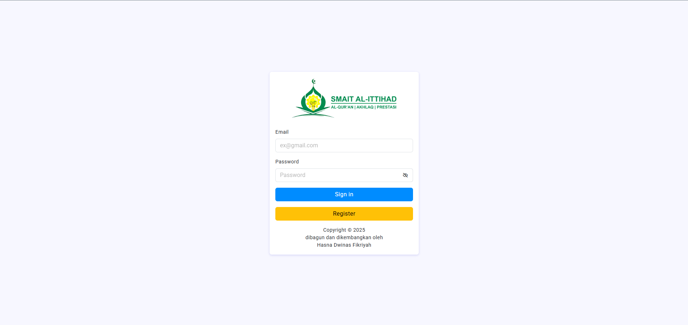

### 3. Role User
#### 3.1 Dashboard
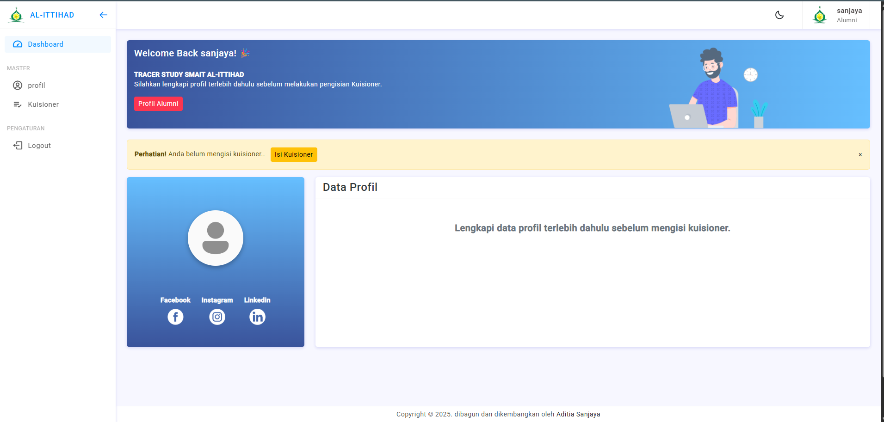
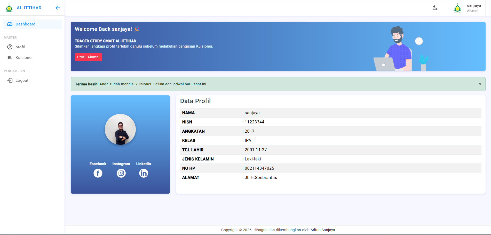

#### 3.2 Pengisian Kuisioner
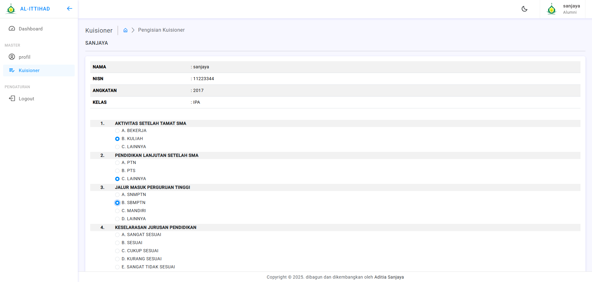

### 4. Role Admin
#### 4.1 Dashboard
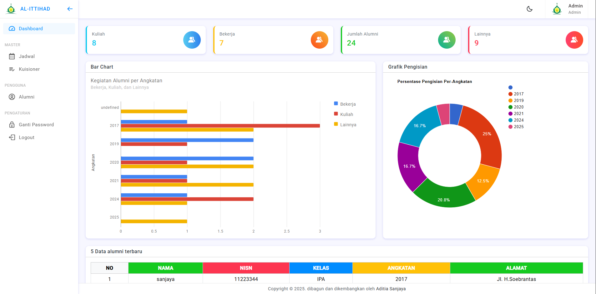

#### 4.2 Jadwal/Periode
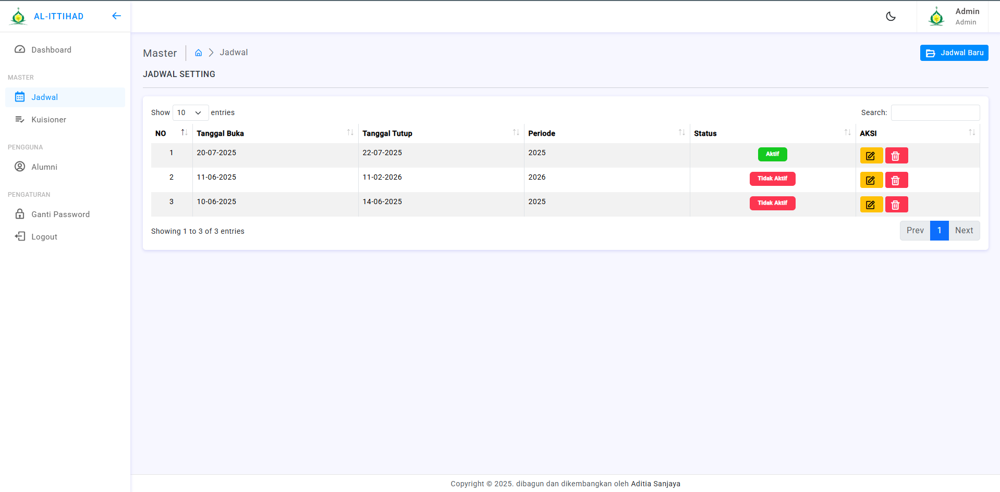

#### 4.3 Kuisioner
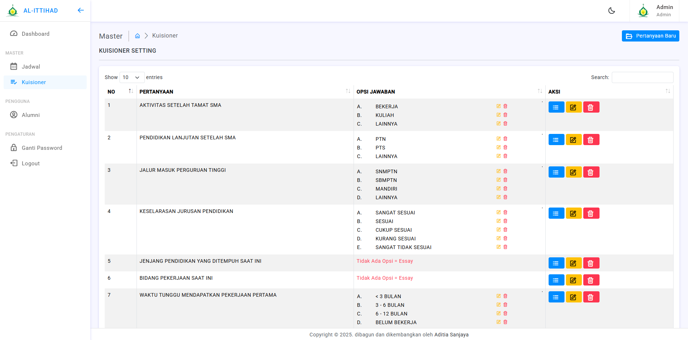
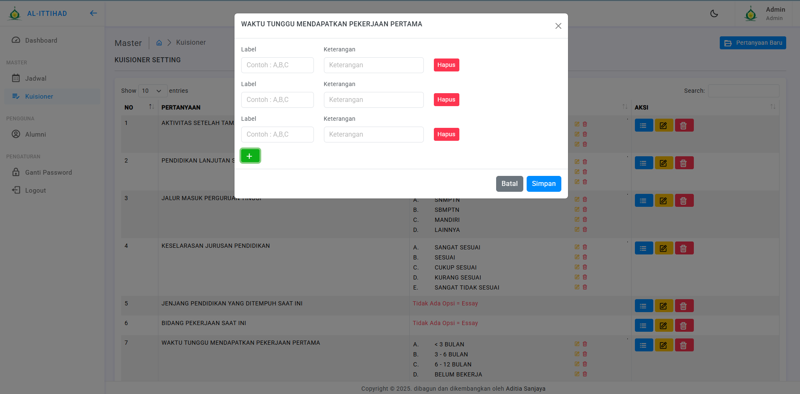

## 👨‍💻 Developer

**Aditia Sanjaya**

GitHub : [@aditia27-sanjaya](https://github.com/aditia27-sanjaya)
Email : aditsanjayaa27@gmail.com
